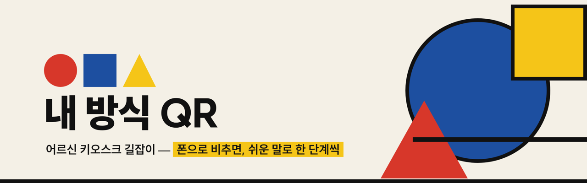
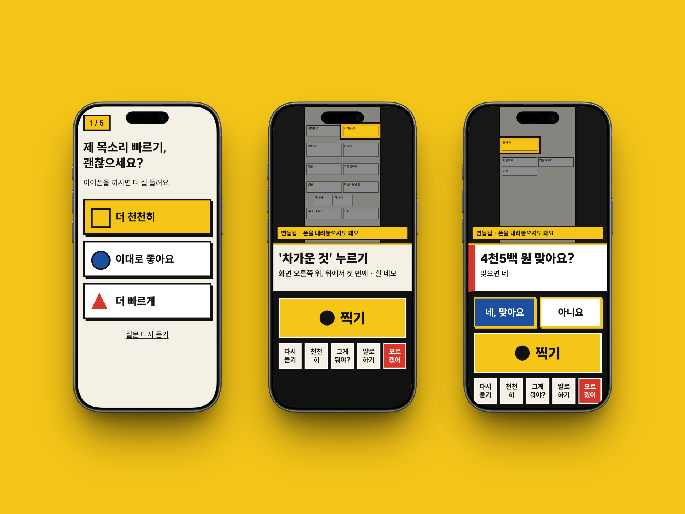
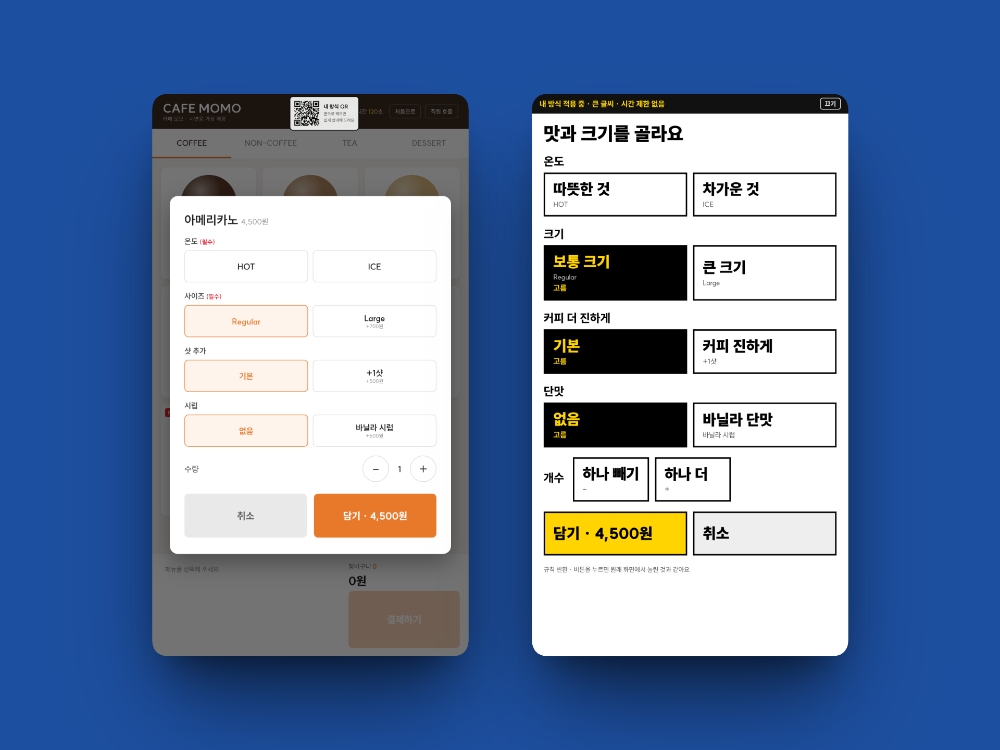

<!-- 구성: Louis3797/awesome-readme-template 을 바탕으로, 로고·색은 랜딩페이지(public/site.css)와 같게 -->
<div align="center">



<h1>내 방식 QR</h1>

<p>아무 키오스크나 폰으로 비추면, 이어폰으로 <b>지금 무엇을 누를지</b> 쉬운 말로 한 단계씩 알려 주는 어르신 키오스크 길잡이</p>

<p>
  
  
  
  
  
</p>

<h4>
  <a href="https://dp44rk.github.io/myway/">서비스 소개</a>
  <span> · </span>
  <a href="https://dp44rk.github.io/myway/demo.html">시연 해보기</a>
  <span> · </span>
  <a href="https://dp44rk.github.io/myway/app/">폰 앱</a>
  <span> · </span>
  <a href="docs/SPEC.md">설계 문서</a>
  <span> · </span>
  <a href="docs/EVAL.md">성능 평가</a>
</h4>

<b>팀 Camelon</b> · 박도연 · 여지원 · 윤진영

</div>

<br>

> "화면 오른쪽 가운데에 주황색 네모가 있어요. 영어로 '테이크 아웃'이라고 써 있어요. 가지고 가기라는 뜻이에요. 그걸 누르세요."
>
> — 이어폰으로 들리는 실제 안내 문장. 위치·색은 AI가 아니라 규칙 코드로 계산해서 매번 같고, 지어내지 않아요.

<br>

<!-- 목차 -->
# :notebook_with_decorative_cover: 목차

- [프로젝트 소개](#star2-프로젝트-소개)
  * [화면](#camera-화면)
  * [기술 스택](#space_invader-기술-스택)
  * [주요 기능](#dart-주요-기능)
  * [색](#art-색)
  * [환경 변수](#key-환경-변수)
- [시작하기](#toolbox-시작하기)
  * [준비물](#bangbang-준비물)
  * [설치](#gear-설치)
  * [테스트](#test_tube-테스트)
  * [로컬 실행](#running-로컬-실행)
  * [배포](#triangular_flag_on_post-배포)
- [사용법](#eyes-사용법)
- [구조](#file_folder-구조)
- [성능 평가](#bar_chart-성능-평가)
- [로드맵](#compass-로드맵)
- [기여 방법](#wave-기여-방법)
- [자주 묻는 질문](#grey_question-자주-묻는-질문)
- [라이선스](#warning-라이선스)
- [팀](#handshake-팀)
- [감사의 말](#gem-감사의-말)

<!-- 프로젝트 소개 -->
## :star2: 프로젝트 소개

2026 AI 라이프 솔루션 챌린지 출품작이에요. 원래 아이디어는 AI 라이프 아이디어 챌린지 5번 후보작 「내 방식 QR: 범용 접근성 프로필 패스」이고, KEIT가 공개한 원제안자 사전질의 답변을 요구사항으로 반영했어요 ([반영표](docs/SPEC.md)).

65세 이상의 64.2%가 키오스크 주문을 어려워해요(보건복지부 2020 노인실태조사). 접근성 기능을 키오스크마다 새로 넣는 방식은 느리게 퍼지기 때문에, 내 방식 QR은 **어르신의 폰에서 시작**해요.

| | 카메라 모드 | 연동 모드 |
|---|---|---|
| 쓰는 곳 | **지금 있는 아무 키오스크** | 「내 방식 QR」 배지가 있는 키오스크 |
| 화면 이해 | 폰 사진 → 비전 모델(Qwen3.8-27B)이 버튼·좌표·화면 종류를 JSON으로 | 키오스크가 자기 화면 구조를 직접 알려 줌 |
| 키오스크 화면 | 그대로 | **AI 화면 변환**: 쉬운 말·묶음·큰 버튼 화면으로 다시 그림 (누르면 원래 버튼과 같음) |
| 폰 | 누를 때마다 "찍기" | 내려놓아도 화면이 바뀌면 자동 안내 |

두 모드 모두 같은 안내 엔진(`server/lib/engine.js`)을 써요. 모델은 "무엇이 보이는지"만 말하고, 결제 확인·권유 거절·위치와 색 말하기·쉬운 말 검사는 규칙 코드가 정해요.

<!-- 화면 -->
### :camera: 화면

<div align="center">
  
  
  <p><sub>왼쪽: 폰 앱 (내 방식 정하기 · 누를 곳 안내 · 결제 확인) &nbsp;|&nbsp; 오른쪽: 원래 키오스크 → AI 화면 변환 · 목업 이미지는 shots.so로 제작</sub></p>
</div>

<!-- 기술 스택 -->
### :space_invader: 기술 스택

<details open>
  <summary>폰 앱 · 웹</summary>
  <ul>
    <li>HTML · CSS · 순수 JavaScript (ES 모듈, 빌드 없음), PWA</li>
    <li>Web Speech API (음성 인식·내장 음성), getUserMedia (카메라)</li>
    <li><a href="https://github.com/cozmo/jsQR">jsQR</a> · <a href="https://github.com/kazuhikoarase/qrcode-generator">qrcode-generator</a> · <a href="https://github.com/juliangarnier/anime">anime.js</a> · <a href="https://sun.fo/suit/">SUIT</a></li>
  </ul>
</details>

<details open>
  <summary>서버</summary>
  <ul>
    <li>Node.js 18+ (http 모듈, 의존성 <a href="https://github.com/jpeg-js/jpeg-js">jpeg-js</a> 하나)</li>
    <li>Air API (OpenAI 호환): Qwen3.8-27B 비전 · DeepSeek-V4.1-Flash 글 · Qwen3-TTS 음성</li>
  </ul>
</details>

<details open>
  <summary>시험 · 배포</summary>
  <ul>
    <li>node:test (단위), Playwright (E2E·화면 맞춤 검사), sharp (평가 사진 변형)</li>
    <li>GitHub Pages (서버 없는 시연), cloudflared (폰 카메라용 HTTPS 터널)</li>
  </ul>
</details>

<!-- 주요 기능 -->
### :dart: 주요 기능

- **내 방식 정하기**: 목소리 빠르기·글씨·키오스크 경험·적립·권유 처리를 1분 안에. 결과는 개인정보 없는 QR로 가족이 대신 보내 줄 수 있어요.
- **목표 말하기**: "차가운 아메리카노 하나, 가져갈게" → 주문 구조로 정리하고 "맞아요?" 하고 되물어요.
- **찍고 듣기**: 지금 누를 버튼 하나를 위치(9칸)·색·적힌 글자·뜻 순서로 말해요.
- **AI 화면 변환**: 연동 키오스크 화면을 쉬운 말 라벨·묶음·큰 버튼으로 다시 설계하고, 검증기가 빠진 버튼·지어낸 버튼을 바로잡아요. 같은 화면은 저장해 다시 써요.
- **쉬운 말 검사기**: 문장 길이, 할 일 개수, 따옴표 밖 외래어를 매번 검사하고, 못 넘으면 템플릿 문장으로 바꿔요.
- **안전장치**: 결제 전 금액 확인, 권유·광고 거절 안내, 3번 막히면 직원 도움 화면.
- **한 화면 원칙**: 폰 앱의 모든 화면은 스크롤 없이 한 화면에 들어가요 (작은 폰 + 아주 큰 글씨까지 검사).

<!-- 색 -->
### :art: 색

랜딩페이지·폰 앱·변환 화면이 같은 색을 써요 (바우하우스 / 데 스테일).

| 이름 | 쓰임 | 값 |
| --- | --- | --- |
| 종이 | 바탕 |  `#f4f0e6` |
| 잉크 | 글자·선 |  `#111111` |
| 빨강 | 원 · 강조 · 도움 |  `#d7372a` |
| 파랑 | 네모 · 연동 · 확인 |  `#1d4fa0` |
| 노랑 | 세모 · 누를 곳 · 주요 버튼 |  `#f5c518` |

<!-- 환경 변수 -->
### :key: 환경 변수

`.env.example`을 `.env`로 복사해서 채워요. endpoint/model id는 Air API 모델 카드의 "코드 보기"에서 확인하세요.

| 변수 | 설명 | 기본값 |
| --- | --- | --- |
| `AIR_API_KEY` | Air API 시크릿 키 (없으면 연동 모드만 동작) | – |
| `AIR_BASE` | Air API 주소 | `https://ap-1.aieev.cloud/endpoints` |
| `VISION_ENDPOINT` · `VISION_MODEL` | 화면 보기 모델 | `qwen-3-8-27b` · `qwen/qwen3.8-27b` |
| `TEXT_ENDPOINT` · `TEXT_MODEL` | 목표 이해·화면 변환 모델 | `deepseek-v4-1-flash-poc-1017` · `deepseek-ai/DeepSeek-V4.1-Flash-1017` |
| `TTS_ENDPOINT` · `TTS_MODEL` · `TTS_VOICE` | 음성 | `qwen3-tts` · `qwen/qwen3-tts-customvoice` · `Sohee` |
| `PORT` | 서버 포트 | `8787` |
| `MOCK_AI` | `1`이면 AI 끔 | `0` |

<!-- 시작하기 -->
## :toolbox: 시작하기

<!-- 준비물 -->
### :bangbang: 준비물

- Node.js 18 이상
- 폰 카메라 시험용 HTTPS 터널: [cloudflared](https://github.com/cloudflare/cloudflared)
- (평가·E2E만) Playwright

```fish
brew install node cloudflared
```

<!-- 설치 -->
### :gear: 설치

```fish
git clone https://github.com/dp44rk/camelon-mywaykiosk.git
cd camelon-mywaykiosk
npm install
cp .env.example .env
```

<!-- 테스트 -->
### :test_tube: 테스트

```fish
npm test                          # 단위 테스트 (안내 엔진·쉬운 말·화면 변환)
node test/e2e-phone.cjs           # 서버 켠 상태에서: 폰 안내대로 키오스크를 눌러 주문 번호까지
node test/e2e-demo.cjs            # 시연 페이지(서버 없는 모드)에서 같은 시험
node test/fit-phone.cjs           # 폰 크기 4종 × 글씨 2종: 넘침 0·겹침 0
```

<!-- 로컬 실행 -->
### :running: 로컬 실행

```fish
npm start                         # http://localhost:8787
npm run tunnel                    # 다른 터미널에서 → https://xxxx.trycloudflare.com
```

| 주소 | 화면 |
| --- | --- |
| `/` | 서비스 소개 |
| `/app/` | 폰 앱 (처음이면 "내 방식 정하기"부터) |
| `/kiosk/cafe.html` · `/kiosk/restaurant.html` | 목업 키오스크 (태블릿·노트북에 띄우기) |
| `/demo.html` | 키오스크 + 폰 나란히 (서버 없이도 동작) |

GitHub Pages의 폰 앱에서 실시간 서버를 쓰려면 `https://dp44rk.github.io/myway/app/?api=<터널 주소>`로 열어요.

<!-- 배포 -->
### :triangular_flag_on_post: 배포

시연 사이트는 정적 파일 묶음을 GitHub Pages에 올려요.

```fish
node scripts/build-pages.mjs ../dp44rk.github.io/myway   # Pages 레포의 myway/ 폴더로 바로
```

시연 음성은 Qwen3-TTS로 미리 녹음해 `public/voice/`에 둬요. 녹음이 없는 문장만 폰 내장 음성으로 말해요.

```fish
node scripts/collect-utterances.cjs   # 시연에서 나오는 안내 문장 모으기 → public/voice/texts.json
node scripts/prerender-tts.mjs        # 문장 단위로 녹음 → public/voice/*.mp3 (API 키 필요)
```

<!-- 사용법 -->
## :eyes: 사용법

어르신의 흐름:

1. 폰에서 `/app/`을 열고 내 방식을 정해요. (처음 1번)
2. "무엇을 주문하실 거예요?"에 말로 답하거나 예시 버튼을 눌러요.
3. 키오스크 화면을 비추고 노란 **찍기** 버튼을 눌러요. 이어폰으로 들은 버튼을 누르고, 다시 찍어요.
4. 키오스크에 「내 방식 QR」 배지가 있으면 그 QR을 찍어요. 키오스크가 내 방식 화면으로 바뀌고, 폰은 내려놓아도 돼요.

한 단계 안내 API:

```bash
curl -s localhost:8787/api/step -H 'Content-Type: application/json' -d '{
  "image": "data:image/jpeg;base64,...",
  "goal": { "items": [{ "name": "아메리카노", "qty": 1, "unit": "잔", "temp": "ice" }], "place": "takeout" },
  "state": {},
  "profile": { "experience": "first" }
}'
# → { "action": "press", "say": "화면 오른쪽 가운데에 …", "target": { "box": [x1,y1,x2,y2] }, "state": { … } }
```

<!-- 구조 -->
## :file_folder: 구조

```
server/            Node 중계 서버 — API 키 보관, 정적 파일 제공
  lib/engine.js    한 단계 안내 핵심 (브라우저·서버 공용)
  lib/guide.js     규칙 플래너(안전장치) + 말 만들기
  lib/layout.js    9칸 위치, 같은 칸 순서, 픽셀/CSS 색 이름
  lib/plain.js     쉬운 말 사전·검사기·지표
  lib/vision.js    사진 → 화면 JSON (비전 모델)
  lib/convert.js   AI 화면 변환 설계 검증·보정 + 규칙 변환
  lib/goal*.js     말 → 주문 구조 + 되묻기
  lib/hub.js       연동 모드: 키오스크 ↔ 폰
public/            서비스 소개(index.html) · 시연(demo.html) · 공통 디자인(site.css) · 움직임(motion.js)
  app/             폰 앱 (PWA)
  voice/           미리 녹음한 시연 음성
kiosk/             목업 카페·식당 키오스크 (가상 매장, 목업 결제)
eval/              평가 세트 생성·카메라 모드 평가·화면 변환·쉬운 말 지표
scripts/           Pages 묶음, 화면 캡처, 음성 미리 녹음
docs/              설계(SPEC)·평가(EVAL)·제출 서류·그림
assets/            README 배너·로고
```

<!-- 성능 평가 -->
## :bar_chart: 성능 평가

목업 키오스크에서 잰 값이에요 (2026-10-29 기준). 자세한 방법과 한계는 [docs/EVAL.md](docs/EVAL.md)에 있어요.

| 지표 | 결과 |
| --- | --- |
| 연동 모드 주문 완료 (폰 안내대로만 누르기) | 목표 5개 중 5개 |
| 화면 변환 성공률 (규칙 변환, 69화면·389버튼) | 100%, 지어낸 버튼 0 |
| 어려운 말 (100어절당, 키오스크 원문 → 안내) | 29.2 → 0 |
| 카메라 모드 버튼 적중률 (276장) | 측정 중 |

규칙 변환과 어려운 말 지표는 같은 사전으로 만들고 같은 사전으로 검사해서 높게 나오는 값이에요. 어르신 사용자 시험은 아직 하지 않았어요.

<!-- 로드맵 -->
## :compass: 로드맵

* [x] 안내 엔진 (규칙 플래너·위치·색·쉬운 말 검사기)
* [x] 목업 카페·식당 키오스크, 연동 모드
* [x] AI 화면 변환 + 검증기 + 케이스 저장
* [x] 폰 앱 (내 방식 정하기·목표 말하기·찍고 듣기·직원 도움)
* [x] 서버 없는 시연 페이지, 서비스 소개
* [ ] 카메라 모드 실측 (Qwen3.8-27B · Qwen3.5-9B 비교)
* [ ] 시연 음성 미리 녹음 (Qwen3-TTS)
* [ ] 실제 매장 키오스크 사진으로 검증
* [ ] 어르신 사용자 시험 (주문 성공률·걸린 시간·도움 요청 횟수)
* [ ] 병원 접수·관공서 키오스크, 다국어

<!-- 기여 방법 -->
## :wave: 기여 방법

브랜치 규칙:

- `main`: 출시 (태그 `v0.1.0-rc1`~)
- `develop`: 통합
- `feat/*` · `fix/*` · `docs/*`: 작업 단위, `develop`에 `--no-ff`로 병합

커밋 메시지는 `feat(app): …`, `fix(server): …`처럼 범위를 붙이고, 무엇을 왜 바꿨는지 한국어로 적어요.

<!-- 자주 묻는 질문 -->
## :grey_question: 자주 묻는 질문

- **앱을 따로 설치해야 하나요?**
  + 아니요. 주소나 QR로 열리는 웹 앱이고, 홈 화면에 추가할 수 있어요.

- **아무 키오스크에서나 되나요?**
  + 카메라 모드는 화면이 보이는 키오스크라면 쓸 수 있지만, 정확도는 측정 중이에요. 연동 키오스크는 키오스크가 화면 구조를 직접 알려 줘서 더 정확해요.

- **결제를 AI가 대신하나요?**
  + 아니요. 누르는 건 사용자예요. 결제 전에는 금액을 읽고 "네"를 받기 전에는 결제 버튼을 안내하지 않아요.

- **제 정보가 저장되나요?**
  + 내 방식 QR에는 설정만 들어가요. 이름·전화번호·장애 여부는 받지 않고, 키오스크 사진은 서버에 남기지 않아요.

<!-- 라이선스 -->
## :warning: 라이선스

아직 정하지 않았어요. 공모전 규정상 아이디어 챌린지 후보작을 바탕으로 한 결과물의 지식재산권은 원제안자와 개발팀이 50:50으로 함께 가져요. 함께 쓴 오픈소스는 각자의 라이선스를 따라요 (`public/vendor/` 안의 라이선스 파일).

<!-- 팀 -->
## :handshake: 팀

<div align="center">
<table>
  <tr>
    <td align="center" width="180"><br><b>박도연</b></td>
    <td align="center" width="180"><br><b>여지원</b></td>
    <td align="center" width="180"><br><b>윤진영</b></td>
  </tr>
</table>
<b>팀 Camelon</b> · <a href="https://github.com/dp44rk/camelon-mywaykiosk">github.com/dp44rk/camelon-mywaykiosk</a>
</div>

<!-- 감사의 말 -->
## :gem: 감사의 말

- [한국산업기술기획평가원(KEIT)](https://www.keit.re.kr/) — AI 라이프 챌린지, 원제안자 사전질의 답변 공개
- 국립국어원 — 고령층 키오스크 쉬운 언어 예시 (2024)
- [jsQR](https://github.com/cozmo/jsQR) · [qrcode-generator](https://github.com/kazuhikoarase/qrcode-generator) · [jpeg-js](https://github.com/jpeg-js/jpeg-js) · [anime.js](https://github.com/juliangarnier/anime) · [SUIT](https://sun.fo/suit/)
- [Shots](https://shots.so/) — 목업 이미지
- [Awesome Readme Template](https://github.com/Louis3797/awesome-readme-template) — 이 README의 틀
